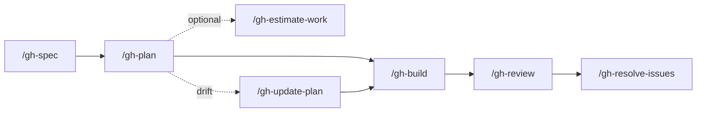

# GitHub SDLC commands (`/gh-*`)

GitHub-native spec → plan → build → review → resolve pipeline. Each entrance command is a thin orchestrator; operational detail lives in `procedures/` and `_scripts/gh/`.

## Flow



## Layout

| Path | Contents |
| --- | --- |
| `gh/*.md` | Entrance commands (user invokes these) |
| `gh/procedures/pipeline/` | GitHub SDLC orchestration procedures |
| `gh/procedures/lib/` | Reusable discipline (TDD, review, security, build) |
| `gh/examples/` | Example JSON payloads and context files |
| `_scripts/gh/` | Publish scripts and helpers |
| `_templates/gh-spec/`, `_templates/gh-review/`, `_templates/planning/` | Templates used by scripts |

Full procedure index: [procedures/README.md](procedures/README.md).

## Scripts

Project-scoped (this repo):

```bash
python3 .cursor/commands/_scripts/gh/gh-spec-publish.py preflight
python3 .cursor/commands/_scripts/gh/gh-build-publish.py preflight
python3 .cursor/commands/_scripts/gh/gh-review-publish.py preflight
python3 .cursor/commands/_scripts/gh/gh-resolve-publish.py preflight
```

User-level installs may mirror the same interface under `~/.cursor/commands/_scripts/gh/`.

## Testing harness

The harness is the pipeline's reward function (workflow-outline §3): seven agent-invokable tiers under `scripts/`, run in order, stopping at the first failure. Exit `2` from a tier means SKIP (no tooling or surface), not failure. Each tier checks for a `scripts/test-tierN-local.sh` override first — the agent curates those; `scripts/` is its verification dumping ground.

| Tier | Script | Checks |
|---|---|---|
| 1 | `test-tier1-lint.sh` | Lint + type (stack-detected) |
| 2 | `test-tier2-unit.sh` | Unit tests |
| 3 | `test-tier3-security.sh` | Secret scan, dependency CVEs, IAM/policy |
| 4 | `test-tier4-integration.sh` | Single-service integration (CDK synth / LocalStack) |
| 5 | `test-tier5-multiservice.sh` | Multi-service on shared staging (local override) |
| 6 | `test-tier6-product.sh` | Product surface — `product-judge` subagent owns the plan |
| 7 | `test-tier7-monitor.sh` | Rollout monitoring, post-merge only (see [§Post-merge](#post-merge-and-release)) |

Scoping (outline §3): `/gh-build` and task-level `/gh-review` run tiers 1–4 (`bash scripts/test-tiers.sh 4`); story/spec-level `/gh-review` runs tiers 1–6 (`bash scripts/test-tiers.sh 6`); tier 7 runs post-merge. No tier is human-gated — the only human checkpoint is PR review. New repos get the tier scripts via `gh-build-publish.py bootstrap-harness` (templates in `_templates/repo-testing/`).

## Promotion

The next-level PR opens automatically once its children are all closed — the same trigger that moves the parent to **Review / QA** (workflow-outline §4.5, §5.3):

- **Story PR** (story branch → spec branch) opens when all task sub-issues of the story are closed.
- **Spec PR** (spec branch → main) opens when all user-story sub-issues of the spec are closed.

Wiring — `_scripts/gh/gh-promote.py`:

| Command | Trigger | Effect |
|---|---|---|
| `on-close --issue REF` | `.github/workflows/promote.yml` on every issue close | If all of the parent's sub-issues are closed: open the parent PR, set parent Status **Review / QA** |
| `on-build --issue REF` | `/gh-build` after `prepare` | Set ancestor story/spec Status **In progress** |
| `promote --issue REF` | Manual | Run the promotion check directly on REF (e.g. after merging the final task PR by hand) |

Parent **Ready to ship** is set by the last `/gh-resolve-issues` run at that level, matching the task lifecycle. Status updates in the workflow need a `PROJECT_STATUS_TOKEN` secret with `project` scope; without it the PR still opens and the status update degrades to a warning.

## Merge strategy

Select the merge method based on the PR's level when the PR is approved:

| PR direction | Method | Reason |
|---|---|---|
| Task → story branch | **Squash merge** | Keeps story history clean; makes single-task revert easy |
| Story → spec branch | **Regular merge** | Preserves task commit grouping in spec branch history |
| Spec → main | **Squash merge** | Keeps main history minimal; makes full-spec revert easy |

The branch ruleset allows `merge`, `squash`, and `rebase` — choose the correct method for the PR level at merge time (see `scripts/github-setup/setup_pr_ruleset.py`).

## Manual review and merge

After `/gh-resolve-issues` completes, the PR is ready for human review.

**Minor feedback** (typos, small refactors, comment wording): developer makes the changes manually and re-requests review.

**Substantial feedback** (new logic, architectural rework, new or changed AC): create a new task or bug issue and loop back through `/gh-build` + `/gh-review`.

Allow up to **2 re-request cycles** before escalating to the story or spec owner.

On approval, use the merge method for the PR's level (see [§Merge strategy](#merge-strategy) above).

**Delete every branch on merge** (workflow-outline §5.1) — task branch on task-PR merge, story branch on story-PR merge, spec branch on spec-PR merge. No branch outlives the PR that consumed it. `scripts/github-setup/setup_repo_merge_policy.py` turns on automatic head-branch deletion for the repo.

## Post-merge and release

After a spec PR merges to main, how work is declared "done" depends on the repo's release tier (declared in `AGENTS.md`):

| Tier | Definition | "Done" means |
|---|---|---|
| **low** | Internal tools — main is always releasable | CI green after merge |
| **medium** | Staging validation required | QA or manual sign-off in staging environment |
| **high** | Production services — staged rollout required | Canary / gradual rollout confirmed before full release |

**Do not close the spec issue at PR merge** — close it only after deployment is confirmed per the repo's tier.

**Link the release or deploy run to the spec issue** (comment with the Actions run URL or release tag) to maintain a paper trail from code to ship.

**Tier 7 — rollout monitoring** (workflow-outline §4.6): after each deploy, run `bash scripts/test-tier7-monitor.sh` to verify staging/production logs and metrics against the expected set (checks live in `scripts/test-tier7-local.sh`; the agent reads the signal, a human only signs off). If tier 7 fails post-deploy, **roll back rather than fix-forward** — the per-level merge strategy is chosen partly to make reverts clean — and file the regression as a bug sub-issue on the spec.

**Update the contract:** run `/write-agents-contract` in diff mode (`main~1...main`) to fold any new architectural decisions, boundaries, or principles into `AGENTS.md`. Skip if the diff is implementation-only and crosses no new architectural boundaries. For a single durable gotcha discovered during build/review, use `/write-agents-contract --pitfall "…"` — agents propose; humans approve before write.

See [shipping-and-launch.md](procedures/lib/shipping-and-launch.md) for launch mechanics.
